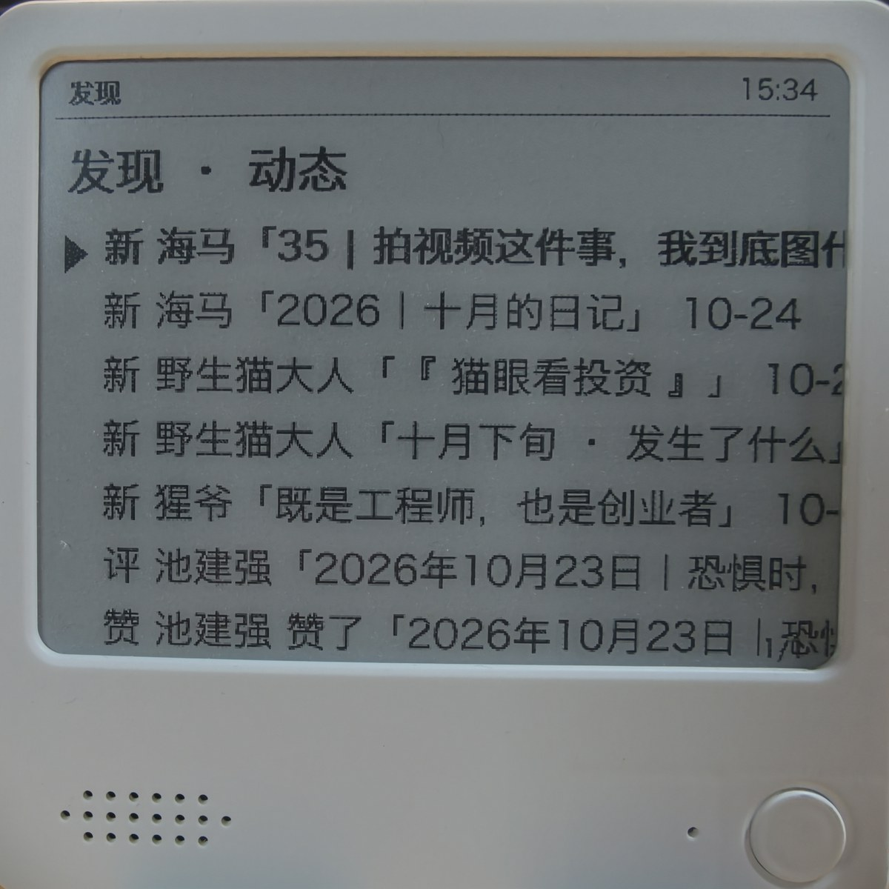
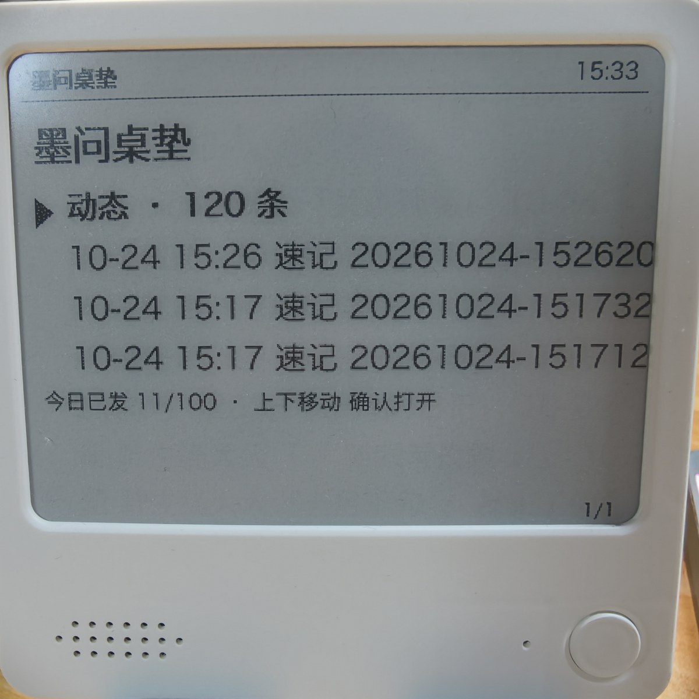
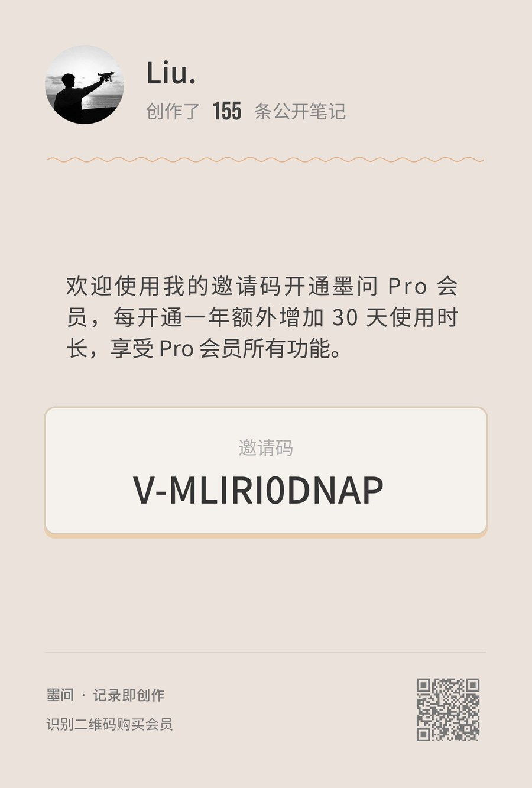

# mowen-desk 墨问桌垫

墨问笔记 → 极趣 Note 4 墨水屏：一台放在桌上的**语音速记机 + 墨问动态阅读器**。
对着墨水屏长按说话，松开即自动发布到墨问；平时按键翻看你的墨问动态（关注的人发新笔记、谁赞了你、评了你）。




- **语音速记**：设备上长按确认键 1 秒说话 → 松开 → 转写（可选 AI）→ 音频附件 + 文字自动发到墨问笔记，全程不掏手机
- **动态阅读**：主页「动态」入口浏览墨问发现流——关注的人发新笔记/付费笔记、被点赞、被评论、被收藏、新粉丝，一行一条，上下键滚动
- **本地回读**：速记内容在本机留档，屏幕可随时翻阅；Down 长按可删除留档条目
- 纯 Rust、单二进制、局域网直连设备，服务器逻辑全部跑在你自己的电脑上

```
                     ┌──────────────────────────────┐
   长按确认键说话 →   │   电脑上的 mowen-desk 常驻程序   │ ← mocli（墨问桌面客户端）
   上下键翻页    ←──  │   速记链路 · 动态拉取 · 渲染      │ ← OpenAPI / AI（可选）
                     └──────┬─────────────────┬─────┘
              局域网推图 UDP │                 │ HTTPS
                            ▼                 ▼
                     极趣 Note 4            墨问
                     (400×300 墨水屏)    (open.mowen.cn)
```

## 环境要求

- **极趣 ZECTRIX Note 4**（zectrix-s3-epaper-4.2），固件 3.7.2，设置里开启「待机保持 Wi-Fi」，与电脑同一局域网
- **墨问 Pro 会员 + API-KEY**（墨问小程序内生成；API 仅对 Pro 会员开放）

> 💡 开通会员时可填邀请码 **`FKD8VGZG`**：你将获得 15 天会员 + 7 天 Pro 会员，作者也会得到会员时长，感谢支持 🙏（详见下图，或在小程序「开通会员」页输入）
>
> 
- Rust stable、C/C++ 编译器与 CMake（SDK 原生 Opus 需要；macOS 装 Xcode Command Line Tools 即可）
- （动态源）本机安装墨问桌面客户端——自动探测其内置的 `mocli`
- （可选）任意 OpenAI 兼容 AI 服务，用于语音转写与速记整理

## 快速开始

```bash
git clone https://github.com/your-name/mowen-desk.git
cd mowen-desk
cp config.example.toml config.toml   # 填入 [mowen].api_key
cargo run --release
```

屏幕出现「墨问桌垫」主页即成功。

> **CMake 兼容提示**：较新的 CMake（≥4.0）构建 SDK 的 Opus 依赖时需要
> `export CMAKE_POLICY_VERSION_MINIMUM=3.5`（Opus 旧版构建脚本所致）。

### 设备 SDK 依赖

`Cargo.toml` 默认以 git 方式依赖 [zectrix-local-push-sdk](https://github.com/itopinion/zectrix-local-push-sdk)。
若你的网络访问 GitHub 困难，可将 SDK 源码放到 `vendor/` 并启用本地补丁：

```bash
git clone https://github.com/itopinion/zectrix-local-push-sdk.git vendor/zectrix-local-push-sdk
mkdir -p .cargo
cat > .cargo/config.toml <<'EOF'
[patch."https://github.com/itopinion/zectrix-local-push-sdk"]
zectrix-sdk = { path = "vendor/zectrix-local-push-sdk" }
EOF
```

`vendor/` 与 `.cargo/` 均已加入 `.gitignore`。

## 日常使用

| 设备操作 | 效果 |
| --- | --- |
| **长按确认键 1 秒，说话，松开** | 语音速记 → 自动发墨问 → 屏幕提示「✓ 已收录」 |
| 上 / 下键（主页） | 移动光标：动态入口、速记留档条目 |
| 确认键（主页） | 打开光标项：动态列表或留档阅读 |
| 上 / 下键（动态/阅读） | 滚动浏览 / 翻页 |
| 确认键（列表/阅读） | 返回主页 |
| **Down 长按（主页）** | 删除光标处留档（带确认屏；仅删本机留档） |
| 动态列表末项「刷新动态」 | 手动拉取（内置 5 分钟冷却，接口限频保护） |

## 配置（config.toml）

| 段.字段 | 必填 | 说明 |
| --- | --- | --- |
| `[zectrix].target` | 否 | 设备 IP / `IP:端口` / 设备 ID；留空自动发现局域网内唯一设备 |
| `[mowen].api_key` | **是** | 墨问 API-KEY（小程序生成，Pro 会员） |
| `[mowen].auto_publish` | 否 | 速记是否自动公开发表，默认 `false`（私密） |
| `[mowen].daily_quota` | 否 | 每日创建配额（默认会员 10 / Pro 100），用于屏幕提醒 |
| `[ai].base_url` 等 | 否 | OpenAI 兼容服务（OpenAI / 智谱等）。不配则速记只上传音频附件，无自动文字 |
| `[feed].source` | 否 | `auto`（默认）/ `discover` / `follows`，见「已知边界」 |
| `[feed].follows` | 否 | `follows` 源：关注作者的 uid 列表 |
| `[feed].refresh_minutes` | 否 | 动态刷新间隔，默认 60 分钟（接口限频严格，不建议 <30） |
| `[render].font_path` | 否 | 中文字体 ttf/ttc；留空自动探测系统字体 |
| `[render].font_size` | 否 | 正文字号，默认 20 |
| `[render].image_format` | 否 | `mono` / `gray4`（默认）/ `gray16` |

AI 配置示例（智谱）：

```toml
[ai]
base_url = "https://open.bigmodel.cn/api/paas/v4"
api_key = "你的key"
chat_model = "glm-4-flash"
asr_model = "glm-asr"
```

## 架构

```
src/
├── main.rs        交互主循环：设备会话/按键/录音事件/断线重连/屏幕状态机
├── mowen.rs       墨问 OpenAPI 客户端：创建笔记、本地上传两步（prepare→投递）
├── discover.rs    动态源：调用墨问桌面客户端 mocli，按官方 mo-discover 技能规则解析
├── feed.rs        动态缓存（discover 主源 / follows 降级源）与限频退避
├── transcribe.rs  OpenAI 兼容 AI：转写、速记整理（未配置则全部优雅降级）
├── render.rs      400×300 渲染：字体探测、中英混排折行、分页、缺字形保护、PNG
├── noteatom.rs    墨问 NoteAtom 笔记结构构造
├── archive.rs     本地留档（data/archive/）与配额计数
└── voice.rs       PCM16→WAV、afconvert 转 M4A（墨问上传白名单不含 WAV）
```

## 已知边界（重要，实测结论 2026-10）

墨问官方 API 为**纯写入**通道，本项目的读取能力来自两类未完全公开的接口，存在失效风险：

1. **`note/list`（scene=1/2/3）**：网关实测可用——搜索全站公开笔记、拉指定作者公开笔记，用于 `follows` 降级源
2. **`mocli disco activity`**：墨问桌面客户端自带的动态命令（官方 mo-discover 技能同源），服务端**限频严格**（连续请求很快 429），且 `--recent 24h` 有概率服务端解析失败（程序自动降档 today → 1h）
3. 墨问**没有删除笔记的 API**：屏幕上的删除仅作用于本机留档，墨问里的笔记请到小程序手动删除
4. 本地上传的音频 MIME 白名单不含 WAV（仅 mp3/m4a 系列），程序先经 `afconvert` 转 M4A 再上传（macOS 自带；其他系统需自行提供转码）
5. 设备同时只允许一个管理方：运行本程序时请勿同时使用极趣官方应用的远程功能

若墨问官方调整上述未文档化接口，动态功能可能失效（速记不受影响）。

## 测试

```bash
cargo test    # 渲染/折行/分页等，无需网络、Key 和设备
```

`render::tests::preview_*` 会把样张写入临时目录，可肉眼检查排版。

## 常驻运行（可选，macOS launchd）

```bash
cargo build --release
cat > ~/Library/LaunchAgents/com.mowen.desk.plist <<EOF
<?xml version="1.0" encoding="UTF-8"?>
<!DOCTYPE plist PUBLIC "-//Apple//DTD PLIST 1.0//EN"
 "http://www.apple.com/DTDs/PropertyList-1.0.dtd">
<plist version="1.0"><dict>
  <key>Label</key><string>com.mowen.desk</string>
  <key>ProgramArguments</key><array>
    <string>$(pwd)/target/release/mowen-desk</string>
  </array>
  <key>WorkingDirectory</key><string>$(pwd)</string>
  <key>RunAtLoad</key><true/>
  <key>KeepAlive</key><true/>
  <key>StandardErrorPath</key><string>$(pwd)/mowen-desk.err.log</string>
</dict></plist>
EOF
launchctl bootstrap gui/$(id -u) ~/Library/LaunchAgents/com.mowen.desk.plist
```

## 致谢

- 设备通信基于 [zectrix-local-push-sdk](https://github.com/itopinion/zectrix-local-push-sdk)（MIT）
- 动态接口语义参考墨问桌面客户端官方 mo-discover 技能文档
- 同类灵感：[weread-ink](https://github.com/hadronliu/weread-ink)

## 许可

MIT（见 [LICENSE](LICENSE)）。

**安全提示**：`config.toml`（含 API-KEY）与 `data/`（含你的笔记留档）已在 `.gitignore` 中，不会被提交；请勿手动移除这两条忽略规则。
